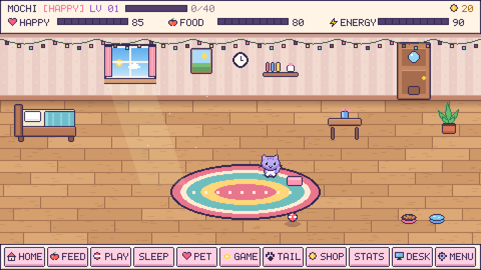

# My Little Pet 🐾

A cozy pixel-art companion by **Teja Priyan**: a Windows desktop pet and an installable mobile web app. Originally called Teja Pet.

[Website](https://tejapriyan.github.io/My-Little-Pet/) · [Mobile app](https://tejapriyan.github.io/My-Little-Pet/app/) · [Guide](https://tejapriyan.github.io/My-Little-Pet/guide.html) · [Report a bug](https://github.com/TejaPriyan/My-Little-Pet/issues)

> Free, Plus and the mobile room are free. No activation or account is needed. Original code and artwork remain proprietary under [LICENSE](LICENSE).

## Meet your companion

- Name yourself and your pet; receive personal greetings without resetting progress.
- Adopt a cat, puppy, bunny, fox, dino, tiger, or parrot, with three coats per species.
- Feed, play, cuddle, rest, earn coins, level up, and unlock accessories and rooms.
- On Windows, let the pet roam over your desktop, follow the cursor, play with a ball, or nap at home. Drag it and use its right-click menu.
- Grow a household of up to four named pets, with separate needs and one shared wallet. Unlock extra slots with earned coins.
- Play Memory Garden and Firefly Rhythm on both platforms, plus Catch the Bug, Treat Drop, Fetch Relay and Garden Hurdles on both platforms, and Treat Hunt on mobile.
- Drag and shrink the desktop house, arrange bowls and toys, or hide the furniture. Click home to walk inside and open the room.
- Buy Seaside Cottage, Woodland Cabin or Moon Suite bundles with matching walls, floors, beds and desktop houses.
- Tap companions for a reaction; choose who to care for in Family. Friends also snack, rest and play on their own.
- Dance, wave, chat and enjoy friendly pillow duels. Choose meals from the pantry.
- Earn slower rewards: 12 daily-goal coins, up to 8 per arcade round, 40 daily game coins, three regenerating lives and free practice.
- Enjoy daily goals, achievements, optional sounds, quiet mode, and local saves.
- Install the mobile web app on Android or iPhone; export and restore mobile backups.

## Download and install

**Windows 10/11, 64-bit:** choose the original Free 1.1.0 or Plus 1.6.0 from the [download page](https://tejapriyan.github.io/My-Little-Pet/#download). Both are free and bundle Python. Verify against [SHA256SUMS.txt](my-little-pet-site/dist/downloads/SHA256SUMS.txt). Installers are unsigned; keep Windows security enabled and contact support if blocked. Press **D** after setup for desktop mode.

**Android / iPhone:** open [the mobile app](https://tejapriyan.github.io/My-Little-Pet/app/) in Chrome on Android or Safari on iPhone. Choose Install app / Add to Home Screen (Safari: Share → Add to Home Screen). Wait for **Ready for offline visits** in Settings. This is a PWA, not an APK or IPA. The mobile pet stays inside the app.

## Saves and privacy

Plus saves retain `%LOCALAPPDATA%/MyLittlePetPlusTest/save` to preserve existing pets. Free installed Windows saves: `%LOCALAPPDATA%/MyLittlePet/save`. Source runs: `teja-pet/save`. Set `MY_LITTLE_PET_SAVE_DIR` to override for isolated development. Mobile saves live in browser local storage. **Desktop and mobile progress are separate.** Back up mobile progress before clearing browser data. The app has no added analytics, ads, or cloud account system; hosting providers process ordinary request logs. Use nicknames for your local pet.

## Ownership and support

Copyright © 2026 **Teja Priyan (TejaPriyan)**. All rights reserved in original material. No reuse, rebranding, resale, or redistribution without written permission except as permitted by [LICENSE](LICENSE), third-party licenses, or law. GitHub's public-repository viewing/forking rights still apply. [Third-party notices](packaging/THIRD-PARTY-NOTICES.txt) remain intact.

See [CONTRIBUTING.md](CONTRIBUTING.md), [SECURITY.md](SECURITY.md), and [CHANGELOG.md](CHANGELOG.md).

## Run and build the free release

- Preview website: `node scripts/serve-site.mjs` (port 4176).
- Python source: `python teja-pet/plus_main.py`. Install dependencies with `pip install -r teja-pet/requirements.txt` first.
- Checks: `python .github/scripts/check.py`.
- Windows executable: `pyinstaller --noconfirm --distpath release-free --workpath packaging/build-free packaging/MyLittlePetPlus.spec`.
- Windows installer: compile `packaging/plus-free.iss` with Inno Setup.
- Public bundle: `node scripts/prepare-public-site.mjs`, then `node my-little-pet-site/tests/public-release.test.mjs`. Use an empty public-site folder.

Optional support: [Buy Me a Coffee](https://buymeacoffee.com/tejapriyan). No features or coins depend on donations.
Support: teja1616150@gmail.com.
